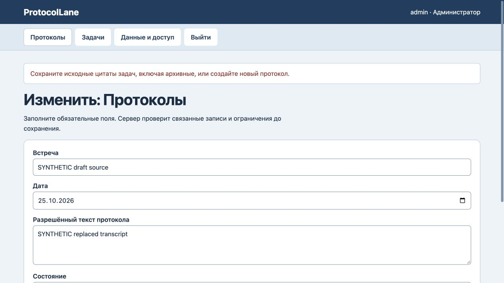
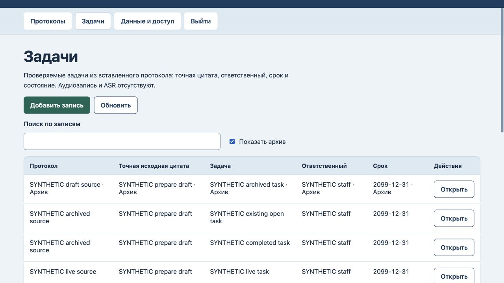

# ProtocolLane: цитаты и архив задач

25 октября2026. На прежнем коде правка чернового протокола удаляла цитату архивной задачи,оставляя историческую ссылку без исходного фрагмента. Архивный протокол допускал новые задачи и повторное открытие завершённой. В редакторе прежней задачи пропадал выбранный архивный источник:обязательное поле становилось пустым и мешало завершить задачу. Три регрессионные проверки сначала упали на baseline.

Теперь правка черновика сохраняет ранее присутствовавшие цитаты всех связанных задач,включая архивные. Новая ссылка,перенос к другому источнику и повторное открытие требуют неархивного протокола. Прежнюю открытую задачу можно завершить;исправления текста/срока и явный перенос к действующему источнику остаются доступны. Редактор сохраняет текущий архивный источник с пометкой «Архив»,новая форма архивы не предлагает.

Все7 тестов прошли,включая файловый перезапуск и восстановление.5 авторизованных HTTP400 отказов и2 браузерных отказа сохранили все данные/версию9/журнал9. В браузере сохранены дополнение к протоколу без удаления цитаты,завершение прежней задачи с исходной связью и новая задача по действующему источнику. После reload/«Показать архив» —5 задач,архивная задача и прежние завершённая/действующая задачи неизменны,версия12/журнал12. [Машинная проверка](history-verification.json).

Старые уже нарушенные архивные цитаты восстанавливаются без автоматического исправления и не блокируют несвязанные записи. Неизменных полных снимков версий текста нет;явная правка источника задачи допустима и журналируется. «Выполнена» — ручная отметка,не подтверждение внешнего исполнения или согласия участника. Схема данных прежняя. Основной сервер перезапущен после проверки владения,18 состояний/версий/журналов не изменились. Аудио/ASR,автоматического извлечения задач,интеграций и промышленного размещения нет. Новый полный аудит интерфейса или безопасности не проводился.
